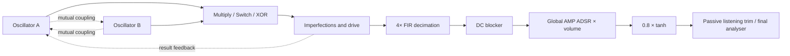

# CLLDR Stage A — fascia and envelope architecture proposal

Status: proposal for review. Stage B is not authorised or implemented.

Brief: [CODEX-NEXT-TASK.md](CODEX-NEXT-TASK.md). Inspected branch `clldr-prototype` at `397db7b`, including the playback fix at `0be1c22`. This document is the only new deliverable; application, DSP, UI, tests and existing configuration files remain unchanged.

## 1. Recommendation and evidence boundary

Use a compact functional header above a bridge fascia: equal A/B source columns, two large tuning rings, a generous shared live display and a long central Collision fader. Put all audition controls in the header. Ring modulation remains present at zero Collision; the fader controls mutual source coupling, never wet/dry.

The initial fascia should contain tuning, waveform selection and Collision. Keep Shape and other continuous source adjustments in oscillator detail initially. This is a recommendation for review, not a conclusion that Shape is uninteresting. Do not add a secondary knob just to occupy space.

Preserve all three exclusive coupling mechanisms and their existing response controls. Do not choose a winning mechanism, change defaults or repurpose feedback during a UI reorganisation.

Code findings below are distinguished from proposed semantics. No new filter or envelope has been auditioned. Control priority, filter character and modulation ranges require review/listening; numerical differences are not a ranking of musical usefulness.

## 2. Current engine and control inventory

Sources: [DSP defaults and sanitisation](dsp.js#L1), [source and interaction loop](dsp.js#L239), [UI bindings](app.js#L69), [audition scheduler](audition.js), [worklet messages](worklet.js), [presets](presets.js), [telemetry](telemetry.js), [visualiser](collision-view.js), [output analysis](analysis.js).

There are **44 persisted scalar fields**: 24 shared fields and 10 for each oscillator. The following tables map every field. Unless noted otherwise, current continuous controls are generic horizontal range inputs. “Small” knobs use adjacent value labels, not central numerical feedback rings.

### Oscillator fields — both A and B

| Fields                       | Current UI / DSP behaviour                                                                                                                  | Proposed home and control                                                                                                                                                                                                                                             |
| ---------------------------- | ------------------------------------------------------------------------------------------------------------------------------------------- | --------------------------------------------------------------------------------------------------------------------------------------------------------------------------------------------------------------------------------------------------------------------- |
| `a.wave`, `b.wave`           | HTML selects: sine, triangle, saw, square. Continuous waveforms also drive mutual modulation; Switch/XOR use some/all signs at combination. | Main fascia, medium four-position segmented selectors aligned to their source rings.                                                                                                                                                                                  |
| `a.ratio`, `b.ratio`         | Independent frequency multipliers, 0.125–8. Defaults A=1, B=1.5.                                                                            | Main fascia, two symmetric **large 270° feedback-ring dials**, central multiplier values and adjacent nominal Hz. Provide exact entry/fine gestures without introducing another stored tuning parameter.                                                              |
| `a.detune`, `b.detune`       | Multiplicative cents offsets, ±100; default 0. Overlap mathematically with ratio but provide fine adjustment.                               | Oscillator detail / Tuning: small amp knobs with cents values. Candidate for promotion only if listening establishes frequent use beyond fine gestures.                                                                                                               |
| `a.offset`, `b.offset`       | Additive Hz, ±1000; default 0. Can cause frequency clamping/stalling and note-dependent relationships.                                      | Oscillator detail / Tuning: small bipolar amp knobs, Hz labels.                                                                                                                                                                                                       |
| `a.tracking`, `b.tracking`   | Independent continuous 0–1 exponents around a 220 Hz reference; default 1. No four-way selector currently.                                  | Header: new four-position Off/A/B/Both selector as a UI binding to existing fields. Oscillator detail retains small partial-tracking knobs. A non-selectable “Fine override” indicator exposes partial states rather than falsely selecting a full-tracking position. |
| `a.phase`, `b.phase`         | 0–360° waveform read offsets; default 0. A's phase setting does not move its hard-sync wrap event.                                          | Oscillator detail / Waveform: small amp knobs, degrees.                                                                                                                                                                                                               |
| `a.shape`, `b.shape`         | −0.85–0.85; default 0. Sine/triangle skew, saw curvature, square pulse width. Meaning differs by waveform.                                  | Oscillator detail / Waveform: medium amp knobs, waveform-specific labels. Fascia promotion remains an explicit decision.                                                                                                                                              |
| `a.dc`, `b.dc`               | Bias −0.8–0.8; default 0. Directly changes multiplication/thresholds and also enters mutual modulation.                                     | Oscillator detail / Waveform: small bipolar amp knobs labelled Bias. Retain independently from Shape.                                                                                                                                                                 |
| `a.sweep`, `b.sweep`         | ±48 semitones; default 0. Independent initial pitch offsets decaying toward zero.                                                           | Envelopes / Existing pitch transients: medium bipolar amp knobs, distinct from the proposed MOD ADSRs.                                                                                                                                                                |
| `a.sweepTime`, `b.sweepTime` | Exponential time constants 0.005–4 s; default 0.3 s. Inactive when corresponding sweep is zero.                                             | Same pitch-transient group: small time knobs, with adjacent units.                                                                                                                                                                                                    |

### Shared persisted fields

| Fields                                  | Current UI / DSP behaviour                                                                                               | Proposed home and control                                                                                           |
| --------------------------------------- | ------------------------------------------------------------------------------------------------------------------------ | ------------------------------------------------------------------------------------------------------------------- |
| `mode`                                  | Three buttons: Multiply, Switch, XOR. Default Multiply; loaded configurations may differ.                                | Header / Mode: small segmented control. Do not reset a loaded mode merely to display the fascia.                    |
| `note`                                  | HTML select, MIDI 24–96; default A3/57. Shared reference, not a guaranteed output fundamental.                           | Header / Tuning: small stepped rotary selector with adjacent note/Hz readout and direct-entry selection panel.      |
| `tune`                                  | ±100 cents; default 0. Applied before key tracking, so not a universal independent output tuning shift.                  | Header / Tuning: small amp knob with external cents value.                                                          |
| `volume`                                | 0–0.85; default 0.45. Gain inside final `tanh`; affects saturation as well as level.                                     | Header / Output: small amp knob, compact final-output meter. Preserve the existing meaning.                         |
| `attack`, `decay`, `sustain`, `release` | The single global amplitude ADSR. Defaults 8 ms / 600 ms / 0.65 / 700 ms; ranges 2 ms–3 s / 10 ms–5 s / 0–1 / 10 ms–8 s. | Envelopes / ENV 1 — AMP: four medium amp knobs, grouped by stage, with a truthful envelope schematic.               |
| `drone`                                 | Checkbox; default false. Opens/retains gate, does not force sustain above its set value.                                 | Header / Audition: small switch. Repeat remains mutually exclusive with Drone.                                      |
| `fm`                                    | Collision fader position 0–1000, displayed 0–100%; default 0. Legacy JSON name retained.                                 | Main fascia: **large long fader**, base percentage, effective-depth label and active coupling mechanism badge.      |
| `coupling`                              | HTML select for original absolute-Hz FM, receiving-frequency-relative FM, reciprocal PM; default Original FM.            | Interaction / Coupling: medium segmented control, with state echoed beside main Collision.                          |
| `curve`                                 | Collision response exponent 0.25–4; default 1.                                                                           | Interaction / Coupling: small amp knob.                                                                             |
| `hzRange`                               | Original FM maximum depth 0–4000 Hz; default 1000.                                                                       | Same group: small amp knob with Hz value.                                                                           |
| `relativeRange`                         | Normalised FM maximum relative depth 0–8; default 2.                                                                     | Same group: small amp knob with relative units.                                                                     |
| `phaseRange`                            | PM maximum depth 0–4 cycles; default 1.                                                                                  | Same group: small amp knob with cycles. All three range settings remain accessible; identify the active one.        |
| `trim`                                  | Passive post-ceiling attenuation −24–0 dB; default 0.                                                                    | Interaction / Comparison: small amp knob. Keep distinct from the saturation-affecting Output control.               |
| `auditionRate`                          | Sample-clock Repeat rate 0.25–8 notes/s; default 2.                                                                      | Header / Audition: small amp knob with notes/s label. No BPM claim or tempo-sync behaviour is implied.              |
| `auditionSequence`                      | Checkbox; default false. Temporary root/+12/−12/+7 sequence, clamped to note limits.                                     | Header / Audition: small switch explicitly labelled temporary pitch test. Not on fascia or a new performance strip. |
| `sync`                                  | Checkbox; default false. A's phase wrap resets B.                                                                        | Interaction / Coupling: small switch labelled A → B hard sync.                                                      |
| `feedback`                              | 0–0.94; default 0. Saturated interaction-result feedback into A frequency plus bounded loop memory.                      | Character / Result feedback: medium amp knob, separate from mutual Collision and from imperfections.                |
| `grit`                                  | 0–1; default 0. Bundles post-interaction drive with deterministic source drift.                                          | Character / Imperfections: medium amp knob, retain explicit Drive + drift label. Do not relabel it a patchable LFO. |
| `asymmetry`                             | ±0.8; default 0. Quadratic term after interaction. In clean XOR with no feedback, predominantly adds removable DC.       | Same group: small bipolar amp knob.                                                                                 |
| `leak`                                  | 0–0.3; default 0. Adds A+B after interaction, also enters result feedback.                                               | Same group: medium amp knob labelled Source leakage.                                                                |
| `noise`                                 | 0–0.15; default 0. Added after combination; enters result feedback, not directly the comparator thresholds.              | Same group: small amp knob.                                                                                         |

The application starts from **Pure**, which overrides B ratio to 2 and AMP sustain/release to 0.8/0.8 s. Initialise uses the DSP defaults. Preserve all seven existing configurations, including nonzero result feedback restored by legacy Drone and Collision.

### Actions, displays and runtime state — not additional persisted fields

| Existing capability                                                        | Current implementation / important distinction                                                                                                                            | Proposed placement                                                                                                                                                                   |
| -------------------------------------------------------------------------- | ------------------------------------------------------------------------------------------------------------------------------------------------------------------------- | ------------------------------------------------------------------------------------------------------------------------------------------------------------------------------------ |
| Enable/resume audio, engine state, messages/errors                         | Shared asynchronous initialisation and cancellable playback requests; worklet errors mute master.                                                                         | Header / Audio: small button, status and bounded live-message area. Preserve the readiness fix.                                                                                      |
| Clean strike                                                               | Sample-clock 180 ms gate, full deterministic DSP reset; sustain when Hold/Drone is active.                                                                                | Header / Audition: medium momentary Strike button.                                                                                                                                   |
| Legacy Strike and Space                                                    | Legacy phase/sweep retrigger retains envelope/filter/feedback memory; UI-timed 180 ms release for the button. Space uses key-down/up gate and ignores form-control focus. | Header / Audition: small Clean/Legacy trigger selector applies to the Strike action; retain keyboard gate and its current focus protections. Do not silently delete the legacy path. |
| Repeat start/stop                                                          | Latching button; 55% gate, clean state per note; disables pitch lock while running.                                                                                       | Header / Audition: medium latching button, with clearly distinct running/pending/stopped states.                                                                                     |
| Hold                                                                       | Latching gate separate from Drone; runtime-only.                                                                                                                          | Header / Audition: small switch. Do not merge its semantics with Drone.                                                                                                              |
| Stop                                                                       | Cancels active/pending audition and releases the amplitude envelope; not an immediate audio kill.                                                                         | Header / Audition: medium button, always available. Preserve release-tail wording.                                                                                                   |
| Initialise and six named tests                                             | Currently a row of seven buttons. Loading is a sound-state change, sometimes starts Drone.                                                                                | Header / Patches: Initialise button and a **dedicated Patch/Test selection panel**, visible tiles/list rather than any dropdown.                                                     |
| JSON export/import                                                         | Version-1 configuration files; import validates/bounds values; runtime state and both snapshots are not exported together.                                                | Header / Patches: small labelled buttons and native file picker. No new patch format in UI-only work.                                                                                |
| Snapshot A/B, store into opposite slot                                     | Full sound/rate/sequence settings; not playback position, pitch-lock correction or both slots in one JSON export.                                                         | Header / Comparison: compact Snapshot A/B segments and Store button; explicit Snapshot label avoids confusion with source A/B.                                                       |
| Capture reference RMS / Match once                                         | Runtime reference and one-shot passive trim; does not boost quiet sounds or provide AGC.                                                                                  | Interaction / Comparison: small buttons and status next to trim.                                                                                                                     |
| Output tuner, note/cents/Hz/confidence, experimental pitch lock/correction | YIN final-output periodicity; correction ±200 cents, confidence/range gated. Not a source-frequency measurement or synchronisation detector.                              | Diagnostics / Tuning; small pitch-lock switch, full readouts.                                                                                                                        |
| Final scope, spectrum, RMS/peak                                            | Final mono analyser after engine conditioning; 8192-point analysis window.                                                                                                | Diagnostics / Output; retain a compact final-level meter in header.                                                                                                                  |
| A/B and interaction histories, frequency/phase statistics                  | Real source telemetry before envelope; bounded 2048-frame windows and pooled transfer buffers.                                                                            | Main visualiser; full numerical statistics in Diagnostics / Sources.                                                                                                                 |
| Telemetry JSON snapshot export                                             | Saves latest bounded window plus metadata/current UI configuration, not a complete automation recording.                                                                  | Diagnostics / Sources: small Export snapshot button.                                                                                                                                 |

No HTML `select`, dropdown popover or menu disguised as a dropdown is proposed. Current waveform, reference-note and coupling selects must be replaced. Small fixed choices use segments/rotary selectors; larger choices use dedicated visible selection panels. Envelope routing uses a destination grid, not a dropdown. Advanced groups use single-level accordions with flat subsections, not nested accordion trees.

## 3. Shape audit and main-fascia hierarchy

**Code facts:** sine Shape warps the positive/negative half-cycle durations; triangle Shape changes the up/down slopes; saw Shape bends curvature; square Shape changes pulse width. Sine, saw and pulse shaping can introduce source DC, so it is not independent of Bias in all contexts. Triangle sign changes can correspond to a phase shift rather than a new sign waveform. Switch discards B's amplitude at combination; XOR discards both amplitudes except their signs. Coupling and leakage can make otherwise similar waveforms distinct again.

A read-only numerical probe at 48 kHz, XOR, no coupling/feedback, B Shape 0 versus 0.6 changed sampled B signs for each waveform (about 27% sine/triangle/pulse, 14% saw in that particular window). This establishes that Shape is not universally ineffective in XOR; it does not establish a preferred sound or distinguish a phase-equivalent change from a new timbre.

**Recommendation:** waveform choice deserves direct fascia access; Shape is a contextual medium control in oscillator detail initially. Its promotion, or that of independent Detune, needs a targeted listening decision. This replaces the earlier assumption that both Shape knobs automatically belong on the main surface. There are only three large continuous controls. Medium and small controls are not replicated to fill symmetrical empty space.

## 4. Bridge composition and responsive behaviour

```text
COMPACT HEADER — all auditioning stays here
 Audio/status | Strike [Clean/Legacy] Hold Repeat Rate Pitch test Drone Stop
 Mode: Multiply / Switch / XOR | Tracking: Off / A / B / Both | Reference / Tune
 Patch/Test panel · Initialise · Import/Export | Snapshot A/B · Store | Output/meter

MAIN FASCIA — one coherent instrument surface
 Oscillator A                 GENEROUS LIVE FIELD                 Oscillator B
 large 270° ring         A trace           B trace                large 270° ring
 setting + nominal Hz       \             /                      setting + nominal Hz
 waveform segments         raw selected interaction              waveform segments
                         B/A nominal relationship
                         ───── COLLISION ─────
                        depth + mechanism state

ADVANCED — collapsed by default, below the complete fascia
 Envelopes | Oscillator detail | Interaction/coupling | Character/Chaos | Diagnostics
```

The header is a compact group, not necessarily one unbroken row. Use two or three short aligned rows depending on width. The fixed brief puts audition here; do not create a duplicate transport below the fascia. A dedicated patch/routing selection panel opens in the editing area below the fascia, not as an anchored floating dropdown. Opening it must not silently switch or initialise a sound.

### Control and readout rules

- Large tuning rings stay symmetric and bind the existing independent ratios. Logarithmic pointer travel is proposed for the six-octave range; fine gesture/keyboard/exact entry supplies precision. Do not reinterpret them as output-fundamental controls.
- Central readouts show the stable base multiplier; adjacent nominal Hz includes the selected note, master tuning, static ratio/detune/offset/tracking, but excludes sweeps, drift, mutual coupling, result feedback and output pitch-lock correction. Use the same nominal definition for B/A; when A is zero/invalid, show “—”, not a misleading ratio. Labels must say nominal. Requested targets outside valid carrier range need an out-of-range indication.
- Instantaneous carrier Hz, wrapped read phase and read-phase velocity remain separate diagnostics. Under PM/sync, read velocity can reverse or jump; do not present it as a conventional measured pitch. Display the active test-sequence note as an actual playing-note indicator while keeping the reference-note control stable.
- Waveform selectors are medium discrete controls; rings and fader dominate. Small knobs have external values. Ring position represents the stored tuning setting, not invented reactive jitter.
- Collision base position remains 0–100%; its active mechanism/depth is always visible even with the coupling panel closed. Multiply is the Initialise default, not an override on imported Switch/XOR sounds.

### Live visual behaviour

A/B share one time axis. Their centres converge as base Collision increases; their actual deformation comes from captured source samples. The third raw-interaction band remains distinct and visible at zero Collision. This prevents the spatial metaphor suggesting that ring multiplication has been bypassed.

Allocate a meaningful lower band to interaction rather than the present thin trace. Label it with the selected operation and identify that it is pre-envelope. Sources/raw interaction can keep moving during silent output; the actual final-output meter indicates attacks, release and silence. Do not infer locking or chaos from fader position or correlation alone. Use colour plus A/B labels, not colour alone, and never independently trigger each trace to create false alignment.

Existing telemetry is approximately 20 packets/s, with 2048 snapshots at output sample rate: 46.4 ms at 44.1 kHz, 42.7 ms at 48 kHz, 21.3 ms at 96 kHz. It samples the last oversample, so it can miss internal events and visually alias. High-rate/low-note windows may contain less than one cycle. It supports this first composition; a longer history, envelope histories or effective modulation indicators would be separate instrumentation changes. Do not fabricate intermediate agitation between packets. Retain bounded transfers/backpressure.

### Responsive targets — to validate, not claims about an implemented design

- At wide widths (roughly 1100 px and above), use narrow symmetric source columns flanking the majority-width display. Reduce header prose and introductory height before reducing the visualiser.
- At intermediate widths, place paired tuning controls above the full-width shared display, with Collision immediately below it. Header audition groups wrap together; do not scatter individual controls into unrelated rows.
- At phone widths, keep the tuning pair side by side, then the visual field and full-width fader. Show waveform segments with their source controls; keep every audition action in the wrapping header. Target about 100–120 px tuning rings and a 140–180 px shared display, with adequate touch hit areas (including small controls). These dimensions are review targets, not final assets.
- Keep the header and entire core composition together in document order, then the advanced editor. Advanced content must not push the display away from its tuning controls. Short landscape windows may need scrolling; preserve legibility and touch targets rather than promising that every control fits every viewport.
- Validate 390×844, 768×1024, 1024×768 and 1440×900 plus browser zoom, keyboard and touch operation. No new sticky overlay should cover the live display or Stop.

## 5. Envelope architecture — existing facts and gaps

### Actual signal path



There is **no musical filter** and no cutoff, resonance or FILTER envelope. The fixed 63-tap FIR is an anti-alias decimator; the DC blocker removes offset. Neither should be repurposed as the instrument's filter or have its protective behaviour modulated.

| Standard role                   | Existing implementation                                                                                                                                                                                                                      | Required work, subject to approval                                                                                                                                                                                |
| ------------------------------- | -------------------------------------------------------------------------------------------------------------------------------------------------------------------------------------------------------------------------------------------- | ----------------------------------------------------------------------------------------------------------------------------------------------------------------------------------------------------------------- |
| ENV 1 — AMP, one global ADSR    | One inline, linear ADSR per mono engine. Before the final soft ceiling, so envelope level also affects saturation. Legacy trigger attacks from current level; clean trigger/repeat resets to zero. Release captures a decrement at note-off. | Present it consistently as AMP. A later shared envelope implementation must preserve exact legacy behaviour with other additions bypassed. No topology/shape replacement is implied.                              |
| ENV 2 — FILTER, one global ADSR | Absent, and there is no musical filter for it to control.                                                                                                                                                                                    | Approved filter topology, placement, cutoff/resonance/bypass semantics, modulation depth and an independent ADSR. An envelope alone cannot satisfy this role.                                                     |
| ENV 3 — MOD A and MOD B         | Absent. Two existing exponential pitch transients share note age but have independent amounts/time constants. They have no ADSR sustain/release or assignment.                                                                               | Two independent ADSR states, complete A/D/S/R controls, oscillator-scoped assignment/depth and optional shared destination semantics. Do not share their stage state or treat them as two depths of one envelope. |

The pitch transients must remain available and round-trip unchanged. An exponential offset decaying toward zero is not an ADSR; silently converting legacy patches would alter Bell/Strike/Collision. If both legacy pitch transient and new MOD-pitch are enabled, show both contributions and add them in pitch units before frequency clamping.

### FILTER decision: options, not an invented approved topology

Prefer the established ZW filter specification if one exists outside this repository; none is supplied here. Review must establish the response/slope and implementation contract before selecting an algorithm. A modest low-pass response and a steeper resonant response are different musical choices, not interchangeable engineering details. Do not add a multimode selector or per-oscillator filters by assumption.

A candidate placement for review is **after decimation/DC blocking and before AMP**, outside the existing result-feedback tap. It would shape the ring-generated spectrum while preserving source trajectories and the distinction between Collision and result feedback. It is not committed by this proposal. Moving it inside feedback or before multiplication would change the instrument substantially and require a different scope.

Proposed ENV 2 control semantics for review: static cutoff plus signed envelope amount in octaves, bounded to the approved filter's safe sample-rate-dependent domain; resonance is a separate static control unless additional routing is expressly approved. Filter disabled means a true bypass preserving legacy audio, not merely zero envelope depth through an audible static filter. Global filter/AMP need not have identical ADSR settings.

### MOD destination shortlist

| Destination              | Proposed meaning                                                                                                              | Assessment                                                                                                                                                 |
| ------------------------ | ----------------------------------------------------------------------------------------------------------------------------- | ---------------------------------------------------------------------------------------------------------------------------------------------------------- |
| Own oscillator Pitch     | Signed semitones, added to pitch exponent after key-tracking reference calculation and before Hz offsets/FM/feedback/clamping | Required destination. Works even with keyboard tracking off. Preserves proportional pitch movement and separate legacy transient.                          |
| Own oscillator Shape     | Signed native-unit offset, summed with static Shape then clamped once                                                         | Useful waveform-dependent candidate. Changes amplitude shape and/or zero crossings; audition across modes.                                                 |
| Own oscillator Bias      | Signed native-unit offset, summed with static DC bias then clamped once                                                       | Directly affects multiplication and comparator thresholds, and the signal used for coupling. Useful experimental candidate.                                |
| Own oscillator Phase     | Signed phase displacement, not accumulator reset                                                                              | Advanced candidate only: can create discontinuities/extra PM and needs aliasing and velocity-telemetry review. Not a harmless slow calibration adjustment. |
| Own oscillator Hz offset | Signed Hz contribution, independent from semitone pitch movement                                                              | Defer unless fixed difference-tone modulation is specifically wanted; overlaps Pitch but has different tracking behaviour.                                 |
| Shared Collision         | Signed displacement in normalised fader-position units                                                                        | Plausible, but changes both directions of coupling; explicit shared assignment and combination rule needed.                                                |

Recommendation for approval: initial assignable destination set **Pitch / Shape / Bias**, with Phase and Hz-offset deferred; optionally add shared Collision using the rule below. Do not expose Ratio and Detune as additional aliases of the same pitch modulation. Do not invent per-source amplitude controls, per-direction FM depths, filter-per-source routing or arbitrary macros to fill the routing panel.

“Freely assignable” needs a cardinality decision. Proposed semantics are one independent envelope per oscillator, with multiple explicit destination rows if approved; one signed depth per route, no implicit normalisation of other routes. The same ADSR shape is shared across that envelope's routes; the two MOD envelopes are independent. A one-destination-per-envelope initial restriction would be simpler but should be an explicit product decision, not an unnoticed limitation.

Use a dedicated destination-selection grid inside the envelope editing area, including an explicit None state and clearly labelled Shared Collision choice. No dropdown, nested menu or floating list anchored to a tiny routing button. Source A's MOD cannot target B-specific parameters and vice versa unless cross-assignment is separately approved.

### Deterministic shared Collision rule — proposal for review

For independent envelope outputs `E_A(t), E_B(t)` in [0,1], signed route depths `d_A, d_B`, and stored fader position `x_base` in [0,1]:

```text
x_effective(t) = clamp(x_base + d_A * E_A(t) + d_B * E_B(t), 0, 1)
active_depth(t) = active_mechanism_range * x_effective(t)^curve
```

Sum first and clamp once. Neither envelope wins by evaluation order; no averaging, multiplication or last-writer assignment. Equal opposite contributions cancel before clamping. Unassigned routes contribute zero. Clamp destination values after all contributions; keep stored settings separate from effective values and never write envelope output back into a patch.

This makes modulation affect fader position consistently across Hz, relative-FM and PM units. It does not make those mechanisms perceptually equivalent. Adding effective modulation after depth conversion would define a different response and is not proposed.

The base fader thumb stays where the user set it; a secondary position/range marker shows effective Collision. Visual source separation should then follow **effective** Collision, not the unmoving base setting. That needs explicit effective-value/envelope telemetry; today's packet has a static depth and no ADSR histories. No fake animation is an acceptable substitute.

### Gates, release and legacy compatibility

All four ADSRs (AMP, FILTER, MOD A, MOD B) receive the same note gate but retain independent times and state. Proposed clean trigger/repeat resets all to zero; legacy retrigger attacks from the current level. Hold/Drone sustain at each envelope's own Sustain setting; neither forces output to one. Note-off releases all; Stop cancels pending/active repetition before release. AMP still determines when output becomes silent, regardless of longer FILTER/MOD releases.

Before implementation, approve how new filter state behaves on clean reset and how mid-stage edits/routing changes are smoothed. Preserve current AMP behaviour in the compatibility path rather than silently changing curves, stage timing or sample order. The current clean scheduler truncates tails; this does not become polyphony or overlapping envelopes.

There is no patchable LFO in the current engine. Do not add a dummy LFO rack in this work. During a UI-only stage, show only implemented AMP and legacy pitch-transient controls; FILTER/MOD headings in this proposal are not permission to render nonfunctional envelope controls.

Legacy v1 migration must retain every field and original defaults, with filter truly bypassed and new MOD routes empty/zero. UI-only work needs no patch-version change. New envelopes/routing/filter settings need a separately approved schema/version migration, sanitisation, defaults and round-trip tests. Keep Snapshot A/B, built-in configurations and Initialise coherent; new effects must not automatically turn on when an old patch is loaded.

## 6. Decisions requiring review before implementation

| Decision                                          | Recommendation / question to approve                                                                                                                                                                                                    |
| ------------------------------------------------- | --------------------------------------------------------------------------------------------------------------------------------------------------------------------------------------------------------------------------------------- |
| D1 — Tuning dial contract                         | Existing independent ratio bindings, logarithmic gestures, central multiplier and adjacent nominal Hz; no new frequency macro. Approve or choose a different explicit binding/readout.                                                  |
| D2 — Immediate source shaping                     | Start with tuning + waveform only; retain Shape/Detune in oscillator detail. Approve promotion of either only after a targeted comparison, not to populate space.                                                                       |
| D3 — FILTER topology                              | Supply/reuse the ZW specification or choose response/slope, resonance range, self-oscillation policy and coefficient/oversampling requirements before choosing an algorithm. There is no current filter to inherit.                     |
| D4 — FILTER placement and bypass                  | Approve post-decimation/DC, pre-AMP, outside feedback as the candidate, or explicitly select another signal path. Approve true bypass for legacy patches.                                                                               |
| D5 — MOD destination scope                        | Approve Pitch/Shape/Bias shortlist; decide Phase/Hz-offset deferral and own-source-only assignments.                                                                                                                                    |
| D6 — MOD routing cardinality and shared Collision | One or multiple routes per envelope? May both target Collision? If yes, approve signed additive, sum-then-clamp position modulation before the response curve.                                                                          |
| D7 — Envelope lifecycle and curves                | Approve independent four-ADSR gates, proposed clean/legacy retrigger semantics, initial curves, signed depths, edit smoothing and filter-state reset behaviour. Preserve AMP compatibility rather than selecting new curves by default. |
| D8 — Initialisation and patch format              | Approve defaults/new schema that keep old patches unchanged. Do not auto-select a different coupling mechanism or filter character as part of the fascia work.                                                                          |

These are specific design decisions for reviewing this document. They are not prerequisites to finishing Stage A, and nothing here grants approval for Stage B.

## 7. Conditional implementation stages and regression gates

This is a proposed subsequent plan, not work executed in Stage A.

| Stage                                   | Scope after explicit approval                                                                                                                                                                                              | Evidence required before moving on                                                                                                                                                                                                                                                                                                                                                                                                                                                                                                                              |
| --------------------------------------- | -------------------------------------------------------------------------------------------------------------------------------------------------------------------------------------------------------------------------- | --------------------------------------------------------------------------------------------------------------------------------------------------------------------------------------------------------------------------------------------------------------------------------------------------------------------------------------------------------------------------------------------------------------------------------------------------------------------------------------------------------------------------------------------------------------- |
| B1 — Existing-engine fascia             | Header audition/configuration/patch grouping; bridge; ZW controls; flat advanced groups; replace every select with segments/rotary/dedicated panels. Preserve all 44 bindings, comparison and diagnostics. No DSP changes. | Current 34 Node tests; existing browser smoke and Repeat regression. Test no selects/disguised dropdowns, pointer/touch/keyboard knob operation, readable focus/value states, partial-tracking overrides, configuration round-trip, and responsive geometry keeping controls/display adjacent. Verify changing layouts/disclosures alone changes no sound setting. Adapt browser selectors for approved segmented/rotary controls while retaining measured-audio, readiness, sequence and patch assertions; do not weaken tests to accommodate the new widgets. |
| B2 — Envelope foundation                | After lifecycle approval, introduce independent envelope state structure while retaining the exact AMP compatibility path; add two MOD ADSRs with approved routes defaulting to zero. Keep legacy pitch transients.        | Sample-clock A/D/S/R timing at 44.1/48/96 kHz, clean/legacy retrigger, independent states, sustain/release, mid-stage edits, Stop during loading, fixed test sequence and percussive actual-output tests. Old FM fixtures remain valid when additions are neutral.                                                                                                                                                                                                                                                                                              |
| B3 — MOD routing and observability      | Approved destination grid, explicit signed amounts, effective-value calculation and bounded telemetry. Shared Collision only if approved.                                                                                  | Own-source isolation, correct semitone/native units, sum-before-clamp, opposite-depth cancellation, saturation, routing-order invariance, no patch feedback, zero-depth bit/tolerance parity, nonfinite input sanitisation, telemetry backpressure, and visuals following effective rather than base values.                                                                                                                                                                                                                                                    |
| B4 — Approved global filter/FILTER ADSR | Implement only the reviewed topology/placement/bypass with independent ADSR and approved cutoff law. Do not retune the protective FIR/DC blocker.                                                                          | Bypass parity with old fixtures; cutoff/resonance limits and stability at all supported sample rates; no DC/nonfinite/out-of-bound output; transient/reset/release tests; final tuner/meters still analyse actual final output. Quantitative filter-response checks and listening are separate requirements.                                                                                                                                                                                                                                                    |
| B5 — Integrated review                  | Confirm all historical presets and patches, A/B preservation, meaningful main readouts, compact header and real traces; document any approved defaults.                                                                    | Run both browser scripts with measured repeated audio, new routing/filter integration cases and responsive tests. Human audition covers ring character, punch, Shape priority, filter character, aliasing, dynamic differences and whether the three large controls remain expressive. No automatic winner or hidden gain correction.                                                                                                                                                                                                                           |

The existing test entry point is `npm test`; browser coverage lives in `tests/browser-smoke.mjs` and `tests/repeat-playback.mjs` with their documented external Playwright/Chromium options. These are regression implications, not claims that new envelope/filter tests already exist or that Stage A reran playback validation.

## 8. Stage A completion boundary

Stage A consists of source inspection, an exhaustive control mapping, bridge/responsive proposal, Shape audit, actual filter/ADSR gap analysis, proposed destination/combination rules, explicit review decisions and the conditional implementation/test plan above.

Only this proposal document is added. No application, DSP, UI, patch, test or setup configuration has been modified. Stage B awaits explicit approval.
